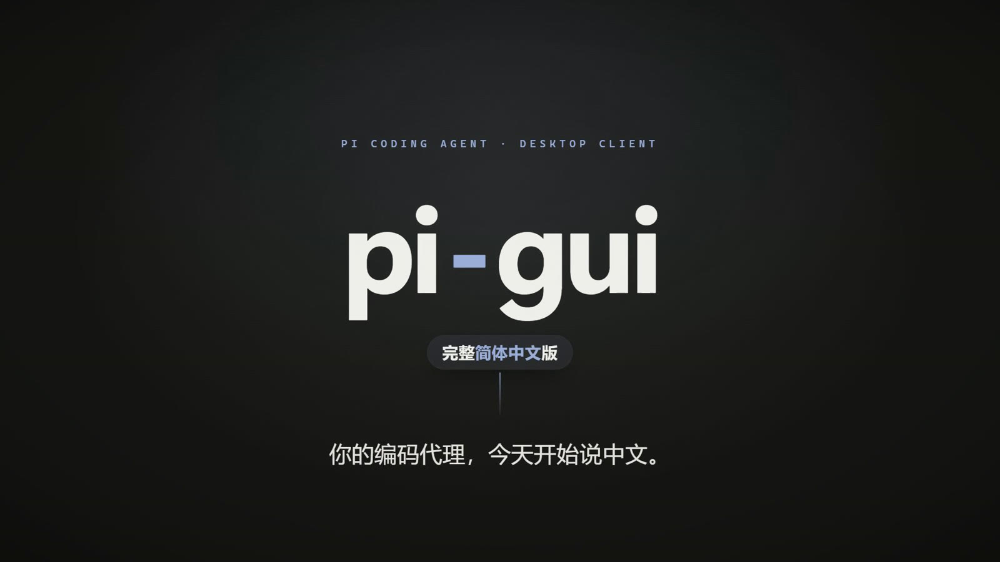
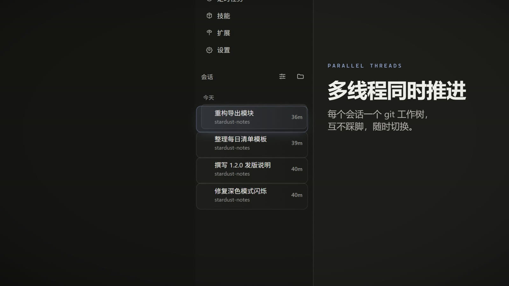
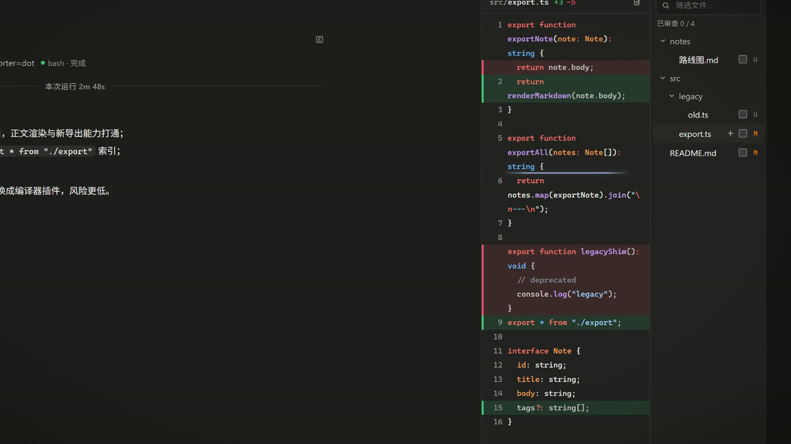
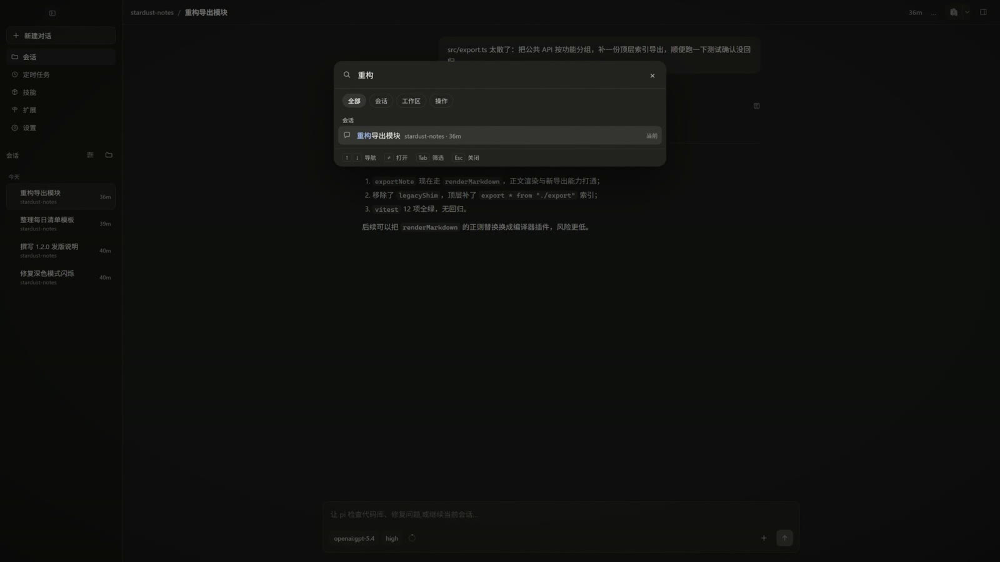
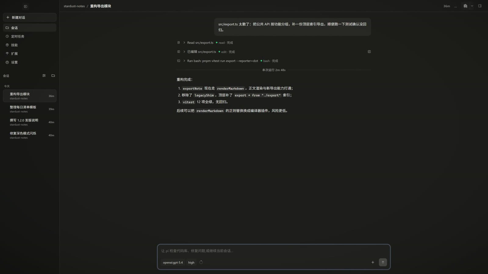

<div align="center">

# pi-gui-zh

**[pi coding agent](https://github.com/earendil-works/pi) 桌面客户端 pi-gui 的完整简体中文版**

[](./LICENSE)
[](./CHANGELOG.md)
[](https://github.com/minghinmatthewlam/pi-gui)
[](./CONTRIBUTING.md)
[](#-功能特性)

_基于上游 [minghinmatthewlam/pi-gui](https://github.com/minghinmatthewlam/pi-gui) · 英文说明见上游 README_

</div>

---

> [!NOTE]
> 本仓库是社区维护的**非官方简体中文版**，与上游 pi-gui 项目没有隶属关系。我们跟随上游版本同步，但可能滞后；与本地化无关的运行时问题请优先反馈给[上游](https://github.com/minghinmatthewlam/pi-gui/issues)。

## 📖 简介

pi-gui 是 pi 编码代理（Codex 风格）的桌面图形客户端。本仓库在上游架构内完成了**全界面、真切换**的简体中文本地化：

- **不是运行时补丁，也不是机器翻译挂件**——全部文案走上游自研的 locale catalog（`apps/desktop/src/i18n/`），源码级接入，约 770 条词条，覆盖率 100%。
- **随时切换**：Settings → Appearance → Language（外观 → 语言）在中英文之间即时切换，所有界面立即生效，缺失词条自动回退英文。
- **跨进程一致**：除渲染进程界面外，原生菜单（macOS）、更新对话框、系统通知也通过 locale IPC 通道跟随当前语言。

## 🎬 宣传片

[](https://ilovemajiaqi.github.io/pi-gui-cn/promo/player.html)

50 秒全中文界面实录：并行会话、命令面板、变更审查、内置终端与定时任务，以及全片高潮——**语言切换即时生效**。点击封面即可在线播放。

- [带 BGM 版](https://ilovemajiaqi.github.io/pi-gui-cn/promo/player.html) · [无 BGM 版（保留音效，方便自配音乐）](https://ilovemajiaqi.github.io/pi-gui-cn/promo/player.html?v=nobgm)
- 画面全部来自真实运行的桌面 app；演示项目「星尘笔记」为虚构数据，不含任何真实会话。
- 工程在 [`promo/remotion`](./promo/remotion)（Remotion + [video-shotcraft](https://github.com/Vincentwei1021/video-shotcraft)），从产品检查、分镜、BGM 卡拍到终检的全过程记录在 [`promo/DESIGN-SPEC.md`](./promo/DESIGN-SPEC.md)。

## 🖼️ 界面预览

| 会话时间线（并行线程）                                | 变更审查（行级 diff）                              |
| ----------------------------------------------------- | -------------------------------------------------- |
|  |  |
| **命令面板（Ctrl+K）**                                | **语言切换即时生效**                               |
|    |    |

## 📚 目录

- [📖 简介](#-简介)
- [🎬 宣传片](#-宣传片)
- [🖼️ 界面预览](#️-界面预览)
- [✨ 功能特性](#-功能特性)
- [📦 安装](#-安装)
- [🚀 使用](#-使用)
- [❓ 常见问题](#-常见问题)
- [🔧 实现要点](#-实现要点)
- [🧭 项目状态](#-项目状态)
- [🗺️ 路线图](#️-路线图)
- [🤝 参与贡献](#-参与贡献)
- [💬 社区与支持](#-社区与支持)
- [🙏 致谢](#-致谢)
- [📄 许可证](#-许可证)

## ✨ 功能特性

pi-gui 本体功能（并行会话线程、git worktree 隔离、变更审查、内置终端、定时任务、技能/扩展管理等）见[上游 README](https://github.com/minghinmatthewlam/pi-gui#readme)。本仓库新增：

- **全界面中文**——侧边栏、新建对话页、会话时间线、命令面板（Cmd/Ctrl+K）、分支树与派生、模型/思考深度选择器、上下文用量面板、文件浏览器、差异审查、集成终端、技能与扩展、定时任务编辑器、设置全部分区、启动/故障恢复页，以及 MCP 登录等原生对话框与后台完成/失败系统通知。
- **语言切换真实生效**——切换后整个应用（含主进程对话框与通知）即时变更；多窗口同步；跟随系统语言自动选择。
- **翻译防回退门禁**——`renderer-copy.spec.ts` 以 TypeScript AST 检查全部已翻译界面的 JSX，硬编码英文一律构建失败，词条永不漂移。
- **翻译质量**——按桌面应用语境统一术语（会话/工作树/审查/上下文窗口/思考深度…），保留 Git 与技术专名。

## 📦 安装

### 环境要求

| 项目     | 要求                                            |
| -------- | ----------------------------------------------- |
| 操作系统 | Windows 10/11 x64、macOS 12+、主流 Linux 发行版 |
| Node.js  | 20 或更高版本                                   |
| 包管理器 | pnpm 10（通过 corepack 管理）                   |

### 方式一：下载安装包（推荐）

前往 [Releases](https://github.com/ilovemajiaqi/pi-gui-cn/releases) 下载对应平台安装包：

| 平台          | 文件                        | 说明                         |
| ------------- | --------------------------- | ---------------------------- |
| Windows x64   | `pi-gui-*-x64-setup.exe`    | NSIS 安装器（推荐）          |
| Windows x64   | `pi-gui-*-x64-portable.exe` | 免安装便携版                 |
| macOS / Linux | 见上游 Releases             | 本仓库发布流水线沿用上游配置 |

> 安装包未做代码签名，首次运行如遇 SmartScreen 提示，选择“更多信息 → 仍要运行”。
> 如果当前版本尚未提供安装包，请使用下面的源码构建方式。

### 方式二：从源码构建

```sh
corepack enable
pnpm install --frozen-lockfile
pnpm package:win      # Windows，产物在 apps/desktop/release/
```

其他平台命令见上游 README（`package` / `package:linux` 等）。

> 🇨🇳 国内网络建议为 electron-builder 配置镜像，并处理两个已知构建坑：
>
> ```sh
> export ELECTRON_MIRROR=https://npmmirror.com/mirrors/electron/
> export ELECTRON_BUILDER_BINARIES_MIRROR=https://npmmirror.com/mirrors/electron-builder-binaries/
> ```
>
> 若 winCodeSign 因符号链接权限失败，以 `-c.toolsets.winCodeSign=1.1.0` 走新版工具集。

## 🚀 使用

1. 安装后首次启动，若系统语言为简体中文则自动进入中文界面；也可手动切换：**Settings（设置）→ Appearance（外观）→ Language（语言）→ 简体中文**。
2. 语言偏好即时生效并跨窗口同步；更新对话框与系统通知同样跟随。
3. 会话数据与上游/官方版完全兼容（存储于 `~/.pi`），可放心交替使用。

## ❓ 常见问题

<details>
<summary><b>中文版和官方版的数据互通吗？</b></summary>

互通。会话、配置与凭据仍由 pi 运行时管理，默认位于 `~/.pi`，两个版本可以交替使用。升级或切换前建议自行备份重要会话。
</details>

<details>
<summary><b>为什么切换语言后还有少量英文？</b></summary>

可能是新增词条尚未翻译，或属于第三方 provider/工具输出。缺失词条会自动回退英文，不会出现空白。欢迎按 [CONTRIBUTING.md](./CONTRIBUTING.md) 补充 `apps/desktop/src/i18n/messages/zh-CN.ts`。
</details>

<details>
<summary><b>Windows 提示“未知发布者”怎么办？</b></summary>

安装包未做代码签名。确认文件来自本仓库 Releases 后，点击“更多信息 → 仍要运行”。请勿从第三方网盘或转载站下载。
</details>

<details>
<summary><b>中文版会上报额外数据吗？</b></summary>

本仓库没有新增遥测。应用与模型 provider 的网络通信、更新检查等行为与上游一致；API Key 由 pi 运行时管理，不会写入本仓库的日志或构建产物。
</details>

<details>
<summary><b>上游更新后，中文版会同步吗？</b></summary>

会尽力跟随，但可能存在延迟。同步策略见[项目状态](#-项目状态)；急需新功能时可先使用上游英文版，或提交 Issue 提醒同步。
</details>

## 🔧 实现要点

| 机制           | 说明                                                                                                                                                               |
| -------------- | ------------------------------------------------------------------------------------------------------------------------------------------------------------------ |
| locale catalog | 英文 `messages/en.ts` 为键源与回退，其他语言是 `Partial<Messages>`；插值、CLDR 复数、RTL 一应俱全（详见 `apps/desktop/src/i18n/AGENTS.md`）                        |
| 防回退门禁     | `tests/unit/renderer-copy.spec.ts` 用 TS AST 扫描 8 个已翻译界面的 JSX，残留硬编码英文即失败                                                                       |
| main 进程通道  | `getLocale` / `setLocale` / `localeChanged` 三条窄 IPC + `LocaleManager`（仿 theme-manager），偏好持久化于 `ui-state.json`（schema v20），macOS 菜单随语言整体重建 |
| e2e 稳定性     | 测试启动固定 `--lang=en-US`，断言英文界面，与上游 CI 环境一致，不受开发机系统语言影响                                                                              |

## 🧭 项目状态

- **维护模式**：以本地化、兼容性修复和上游同步为主，不改变 `pi` 运行时行为。
- **同步策略**：优先跟进上游新版本与新增界面词条；较大的上游重构会先保证可构建、可启动，再补齐翻译。
- **质量门禁**：`pnpm check`（格式、lint、架构守卫、类型、单元测试）与桌面 e2e 均需通过；UI 改动要求在真实 Electron 界面验证。
- **版本号**：与上游桌面端版本保持一致，本项目自身的修复记录在 [CHANGELOG.md](./CHANGELOG.md)。

## 🗺️ 路线图

- [ ] 将三个 i18n 提交拆分回馈上游（`threads/app` → `其余 renderer 面` → `main locale 通道`）
- [ ] 繁体中文（`zh-Hant`）语言包（catalog 已支持 script 级匹配）
- [ ] 补全 e2e 对双语界面的兼容策略
- [ ] 跟随上游版本节奏同步新增界面词条

想参与其中一项？欢迎先在 [Discussions](https://github.com/ilovemajiaqi/pi-gui-cn/discussions) 或 Issue 中认领。

## 🤝 参与贡献

欢迎纠错、补充翻译和提交兼容性修复！请先阅读 [CONTRIBUTING.md](./CONTRIBUTING.md) 与 [CODE_OF_CONDUCT.md](./CODE_OF_CONDUCT.md)。

1. 词条位于 `apps/desktop/src/i18n/messages/en.ts`（键源）与 `messages/zh-CN.ts`（中文）；
2. 检查工具：`pnpm i18n:check zh-CN` 列出缺失或仍为英文的词条；
3. 提交前请通过 `pnpm check`（格式化、lint、架构守卫、类型、单元测试）；
4. 提交 PR 时请使用仓库的 [PR 模板](./.github/PULL_REQUEST_TEMPLATE.md)，说明验证方式。

## 💬 社区与支持

| 需求           | 渠道                                                                                                           |
| -------------- | -------------------------------------------------------------------------------------------------------------- |
| 使用问题与交流 | [Discussions](https://github.com/ilovemajiaqi/pi-gui-cn/discussions)                                           |
| Bug 与功能建议 | [Issues](https://github.com/ilovemajiaqi/pi-gui-cn/issues)（请使用模板）                                       |
| 安全漏洞       | [私密报告](https://github.com/ilovemajiaqi/pi-gui-cn/security/advisories/new)，见 [SECURITY.md](./SECURITY.md) |
| 更多帮助       | [SUPPORT.md](./SUPPORT.md)                                                                                     |

## 🙏 致谢

- [Matthew Lam（minghinmatthewlam）](https://github.com/minghinmatthewlam) 与 pi-gui 的全体贡献者——本仓库的全部价值都建立在这个优秀的项目之上，上游内置的 i18n 框架为中文版铺平了道路；
- [pi coding agent](https://github.com/earendil-works/pi) 及 [pi-mono](https://github.com/badlogic/pi-mono) 生态；
- 一并感谢上游为剩余界面国际化预留的设计与文档。

## 📄 许可证

[MIT](./LICENSE) © Matthew Lam、pi-gui-zh 贡献者及上游贡献者。本仓库的翻译与本地化改动在同等 MIT 协议下提供；上游原始版权声明已保留在 [LICENSE](./LICENSE) 中，第三方组件与素材见 [NOTICE.md](./NOTICE.md)。
